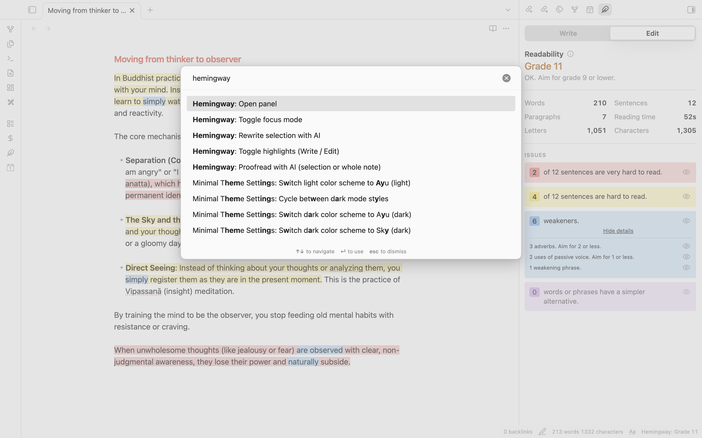

# Hemingway for Obsidian


> **Not affiliated with Hemingway Editor.** This is an independent, unofficial, community-made plugin. It has no connection to Hemingway Editor, the Hemingway App, or Boondoggle Studio, LLC, the owner of [hemingwayapp.com](https://hemingwayapp.com/). Those names belong to their owners and are used only to describe the kind of feedback you get. No code, logos or text came from that site. Want the official product? Go there.

I use the Hemingway app every day. My notes live in Obsidian, so I kept copying text out, pasting it into a browser tab, and pasting it back. A dumb way to spend a Tuesday.

So this does it inside your notes. You type, highlights show up. No account, and nothing leaves your computer.

## The colors

| Color | Meaning |
| --- | --- |
| Red | Very hard to read. Your reader is lost. |
| Yellow | Hard to read. Shorten it or split it. |
| Blue | An adverb, a passive verb, or a hedge like "just". |
| Purple | There's a plainer word. "Utilize" wants to be "use". |

## What it does

- **Highlights as you type** in Live Preview, Source mode and Reading view. It skips front matter, code and links.
- **Click a highlight** and a small card explains it. One button fixes it: swap the word, delete it, or ignore it for good.
- **Side panel** with the grade, word count, reading time and a count per problem type. Each has an eye icon, so you can mute the blue and keep the yellow.
- **Write and Edit tabs.** Write hides highlights so you can draft. Edit brings them back.
- **Focus mode** hides the sidebars, tabs and status bar.
- **Goals** for a note or a day, with a streak counter. Off by default. Some people find streaks motivating. Others find them a small daily lawsuit.

### Optional local AI

Off by default. Turn it on in settings and the plugin downloads a model once (Llama 3.2 3B Instruct, Q4 MLC, about 2.3 GB). After that it runs offline on your graphics chip. It needs WebGPU, which recent desktop Obsidian has.

**Rewrite with AI.** Yellow and red sentences get a button. You see the suggestion first, then apply it or ask for **Another option**. To rewrite anything, select it and right-click.


**Proofread with AI.** Fixes typos, grammar and repeated words without rewriting your sentences. You get a checklist, tick what you want, and it applies as one undo step. It never touches links, code, front matter or numbers.


## What it doesn't do

No cloud AI and no tone changer. It's not a replacement for the paid Hemingway app.

The grade matched the real one on the note I tested (Grade 8, same sentence counts). But I wrote the word lists myself, so you'll sometimes get a flag the website wouldn't, or miss one it would. Open an issue. Those are usually a one-line fix.

## Install

- **Community list:** Settings → Community plugins → Browse → "Hemingway".
- **By hand:** grab `main.js`, `manifest.json` and `styles.css` from the [latest release](../../releases/latest). Put them in `<vault>/.obsidian/plugins/hemingway/`, restart, and enable it.
- **BRAT:** add `dhruvir-zala/hemingway-for-obsidian`.

## Commands

| Command | What it does |
| --- | --- |
| Toggle highlights (Write / Edit) | Shows or hides highlights |
| Toggle focus mode | Hides the sidebars, tabs and status bar |
| Open panel | Opens the side panel |
| Rewrite selection with AI | Rewrites the selected text |
| Proofread with AI (selection or whole note) | Proofreads the selection, or the note if nothing's selected |

Give them hotkeys in Settings → Hotkeys. I'd start with the first one.



## Settings

Change the target grade (9 by default), reading speed, and which highlights are on. Add your own hedge phrases, plus a list of words to never flag. That list is for words you use on purpose. Nobody's taking "very" away from you, but the plugin will mention it.

The **AI rewrite (optional)** section is where you pick a style and download or delete the model.


## How the grade works

Same published formula as the Hemingway app: `4.71 × (letters ÷ words) + 0.5 × (words ÷ sentences) − 21.43`. A sentence is "hard" at 14+ words and grade 10+, "very hard" at grade 14+. Markdown is stripped first. The word lists live in [`src/lexicon.ts`](src/lexicon.ts) if you want to see what it's judging you on.

## Build it yourself

```bash
npm install
npm run dev      # rebuilds on save
npm run build    # type-checks and makes main.js
npm test         # analyzer and proofreading tests
```

Symlink the repo into `<vault>/.obsidian/plugins/hemingway/` and reload Obsidian. More in [CONTRIBUTING.md](CONTRIBUTING.md).

**Releasing:** run `npm version minor` (or `patch` / `major`), then `git push --follow-tags`. A GitHub Action tests, builds and drafts the release. Open the draft and publish.

## Contributing

Bug reports and word-list fixes are welcome. The best report has the sentence, the wrong highlight, and what you expected. Don't copy anything from hemingwayapp.com. Everything here has to be written independently.

## Support

If it's useful, you can [buy me a coffee on Ko-fi](https://ko-fi.com/dhruvirzala). Thank you.

## License

[MIT](LICENSE). All trademarks belong to their owners, and nothing here implies endorsement.
