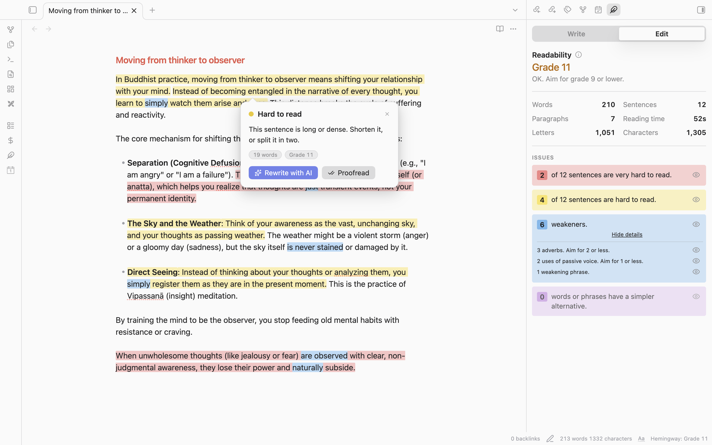
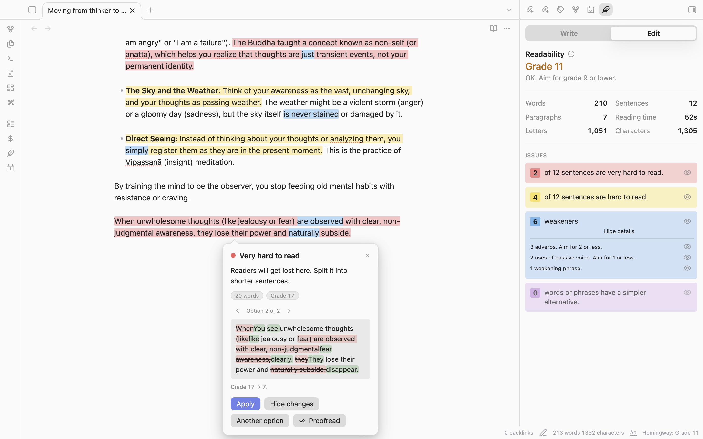
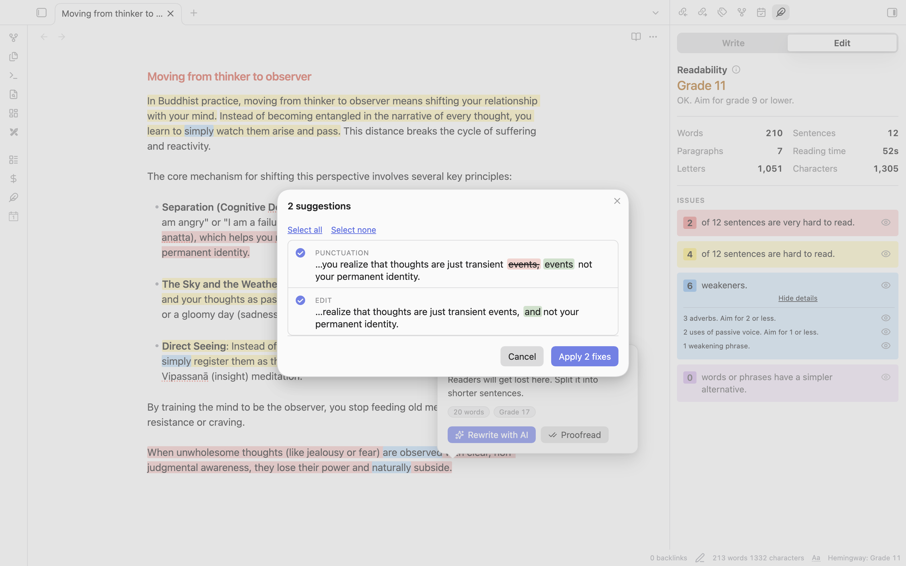
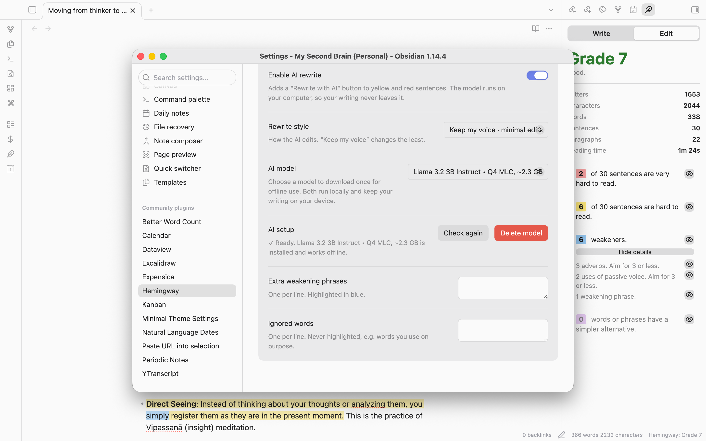

# Hemingway for Obsidian



> ## ⚠️ Not affiliated with Hemingway Editor
> **Hemingway** (this plugin) is an **independent, unofficial, community-made** plugin. It is **not affiliated with, endorsed by, sponsored by, or connected to** Hemingway Editor, the Hemingway App, or Boondoggle Studio, LLC, the owner of [hemingwayapp.com](https://hemingwayapp.com/). "Hemingway Editor" and "Hemingway App" are trademarks of their respective owners and are used here only to describe the style of feedback this plugin gives. This plugin contains no code, logos, text or other assets from hemingwayapp.com. If you want the official product, including its AI and grammar tools, use [hemingwayapp.com](https://hemingwayapp.com/).

I use the Hemingway app every day. It's the best thing I know for catching a sentence that's trying too hard. But my notes live in Obsidian, so every time I wanted feedback I was copying text out, pasting it into a browser tab, fixing things there, and pasting it back. Which is a dumb way to spend a Tuesday.

So this plugin does the same kind of thing right inside your notes. You type, the highlights show up. No window to open, no account, and nothing leaves your computer.

## What the colors mean

| Color | What it's telling you |
| --- | --- |
| Red | This sentence is very hard to read. Your reader is going to get lost. |
| Yellow | This sentence is hard to read. Shorten it or split it. |
| Blue | An adverb, a passive verb, or a hedge like "I think" or "just". |
| Purple | There's a plainer word for this. "Utilize" wants to be "use". |

When a blue or purple word sits inside a yellow sentence, the word wins. You can still see both. You just don't get a muddy brown mess.

## What it does

**It highlights as you type.** Live Preview, Source mode and Reading view all work. I tested on a note full of front matter, code blocks and links, because my first version choked on front matter and froze Obsidian. That's fixed, and it's got a test now.

**You click a highlight and it explains itself.** A small card pops up with a one-line reason and a button. For a purple word, the button swaps in the simpler one. For an adverb or a hedge, it deletes the word and cleans up the spacing and commas. If it removes the first word of a sentence, it capitalizes the next one so you don't have to. If two problems land on the same spot, a little `‹ 1/2 ›` lets you flip between them. And if a word is fine and the plugin is just wrong, "Ignore" tells it to leave that word alone from now on.

**The side panel gives you the grade.** It shows the reading grade, letters, characters, words, sentences, paragraphs and reading time, plus a card for each type of problem with a count. Each card has an eye icon, so if the blue is driving you nuts today, you can turn it off and keep the yellow.

**Write and Edit tabs.** Write hides every highlight so you can just draft. Edit turns them back on. That's the whole trick, and it's the right one. Nobody drafts well while a screen is yelling at them.

**Select some text and the panel switches to that.** Handy when you only care about one paragraph, and the status bar says "Selection" so you don't forget what you're looking at.

**Goals, if you want them.** Set a word goal for a note, or a daily goal across everything. You get a progress bar and a streak counter. They're both off by default, because some people find a streak motivating and some people find it a small daily lawsuit.

**Focus mode.** Hides the sidebars, tabs and status bar. There's a faint "Exit focus" button in the corner for when you come up for air.

**Optional local AI rewrite.** Turn it on in settings and yellow and red sentences get a "Rewrite with AI" button. You see the suggestion first, then apply it or click **Another option** to request another version. Passive-voice highlights offer a sentence rewrite too. To rewrite any text, select it and right-click → "Hemingway: rewrite selection" (or use the command "Rewrite selection with AI" and give it a hotkey). The built-in model is **Llama 3.2 3B Instruct • Q4 MLC** (about 2.3 GB), which runs inside Obsidian on your graphics chip. It is not a GGUF Q4_K_M/Q8_0 file. Open Hemingway's settings and click **Download & enable**; the model downloads once and then runs offline. Your writing never leaves your computer. It needs WebGPU, which recent desktop Obsidian has. It's off by default.



**Proofread with AI.** A separate tool that fixes mistakes without rewriting your sentences. Right-click → "Hemingway: proofread note" (or select text first to check just that), click **✓ Proofread** on a highlight card, or run **Proofread with AI (selection or whole note)**. It checks typos, punctuation, grammar, wrong words and repetition in one pass. You get a list of individual fixes, each with a checkbox, and apply the ones you want as a single undo step. The plugin rejects any result where the model changes too many words, and it never touches links, code, front matter or numbers.



## What it doesn't do

No cloud AI: optional AI rewriting and proofreading run on your device with a model you download. This is not a full substitute for the Hemingway app's paid tools, and it does not offer cloud AI or tone-changing tools.

The grade matches the real one on the sample note I checked it against (Grade 8, same sentence counts). But I wrote the word lists myself, so on your writing you'll sometimes see a flag the website wouldn't give you, or miss one it would. If you find one, open an issue. Those are usually a one-line fix.

## Install

### Once it's in the community list
Settings → Community plugins → Browse → search for "Hemingway".

### By hand
1. Grab `main.js`, `manifest.json` and `styles.css` from the [latest release](../../releases/latest).
2. Put them in `<your vault>/.obsidian/plugins/hemingway/`. You may have to make that folder.
3. Restart Obsidian and switch on **Hemingway** under Settings → Community plugins.

### With BRAT
Add `dhruvir-zala/hemingway-for-obsidian` in the [BRAT](https://github.com/TfTHacker/obsidian42-brat) plugin.

## Commands

| Command | What it does |
| --- | --- |
| Toggle highlights (Write / Edit) | Shows or hides every highlight |
| Toggle focus mode | Hides the sidebars, tabs and status bar |
| Open panel | Opens the Hemingway side panel |
| Rewrite selection with AI | Rewrites the selected text locally with AI |
| Proofread with AI (selection or whole note) | Suggests selectable proofreading fixes for the selection, or the whole note if nothing is selected |

Give them hotkeys in Settings → Hotkeys. I'd start with the first one.

## Settings

You can change the target grade (9 by default), your reading speed for the reading-time number, and which types of highlight are on. You can add your own hedge phrases, one per line, and a list of words to never flag. That second list is for the words you use on purpose. Nobody's taking "very" away from you, but the plugin will mention it.

AI rewriting is off by default. In the **AI rewrite (optional)** settings, choose a rewrite style and download the built-in model. AI requires WebGPU; the first model download needs an internet connection and uses about 2.3 GB of storage. After downloading, rewriting and proofreading run locally and work offline. You can delete the model from settings to free its storage.



## How the grade works

It's the same formula the Hemingway app uses: `4.71 × (letters ÷ words) + 0.5 × (words ÷ sentences) − 21.43`. A sentence is "hard" when it has 14 or more words and lands at grade 10 or higher, and "very hard" at grade 14 or higher. It strips out markdown first, so front matter, code, links, embeds and comments don't count and don't get flagged. Everything runs on your machine. The word lists are in [`src/lexicon.ts`](src/lexicon.ts) if you want to see exactly what it's judging you on.

## Building it yourself

```bash
npm install
npm run dev      # rebuilds when you save
npm run build    # type-checks and makes main.js
npm test         # runs the analyzer and proofreading tests
```

Copy or symlink the repo into `<vault>/.obsidian/plugins/hemingway/`, reload Obsidian, and you're testing your own changes. More in [CONTRIBUTING.md](CONTRIBUTING.md).

### Cutting a release

1. `npm version minor` (or `patch` / `major` as appropriate). It updates the version metadata and makes the tag.
2. `git push --follow-tags`. A GitHub Action tests and builds the plugin, attests the release assets, and drafts a release with generated notes and the three files.
3. Open the draft and hit publish.

## Contributing

Bug reports, word-list fixes and translations are welcome. The best bug report has the sentence, which highlight was wrong, and what you expected instead. Don't copy anything from hemingwayapp.com, though. Everything here has to be written independently.

## Support the project

If Hemingway for Obsidian is useful to you, you can [buy me a coffee on Ko-fi](https://ko-fi.com/dhruvirzala). Thank you for supporting its development.

## Trademarks

All product names and trademarks belong to their owners, and using them here doesn't mean anyone is affiliated with or endorses anyone. The grade uses a published formula, the word lists are my own, and nothing was copied from hemingwayapp.com.

## License

[MIT](LICENSE)
